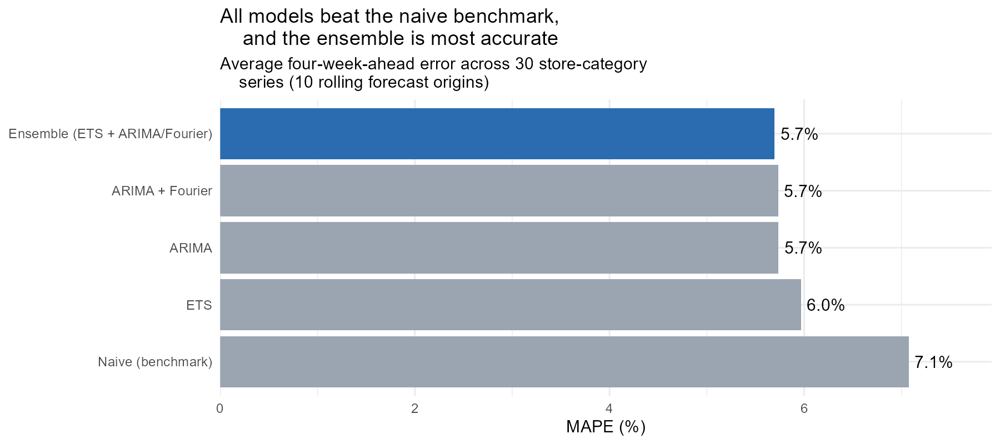
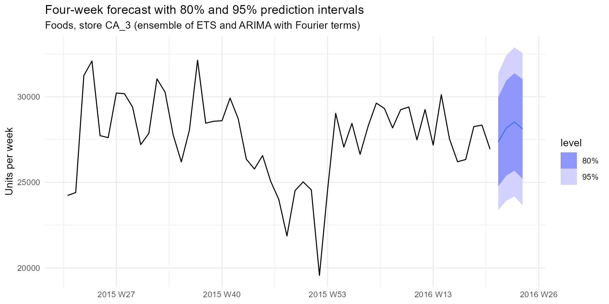

# Weekly Demand Forecasting: Walmart Store Sales (M5)

Forecasting weekly unit sales four weeks ahead for 10 Walmart stores across California, Texas, and Wisconsin, to answer: **how accurately can we forecast demand, and which method should a planning team use?**

**Tools:** R · tidyverse · fable / tsibble / feasts · Quarto

  📄 **[Read the full report](https://brandon-keck.github.io/forecasting_accuracy/forecasting_accurace.html)**

---

## TL;DR

- **Recommended method: an ensemble** averaging exponential smoothing (ETS) and ARIMA with Fourier seasonality terms.
- It forecasts four weeks ahead with an average error of **5.7% (MAPE)**, about **19% less error** than the naive "same as last week" benchmark (7.1%).
- Its prediction intervals are **well calibrated**: 80% and 95% intervals contained actual sales 83.8% and 95.9% of the time, so the ranges can be trusted for safety-stock planning.
- No single model won every category: ARIMA with Fourier terms was best for Foods, while plain ARIMA was best for Hobbies and Household. A category-specific approach is a promising next step to validate.

---

## Data

The [M5 Forecasting competition](https://www.kaggle.com/competitions/m5-forecasting-accuracy) dataset: about five years (2011–2016) of daily unit sales for ~30,000 Walmart products across 10 stores. Daily product sales were aggregated to **weekly totals by store and category** (Foods, Household, Hobbies), giving **30 weekly series of 277 weeks each**, the level at which a supply chain team would plan inventory. Partial weeks at the start of the data were dropped.

---

## Key Findings

### What the data looks like
- **Foods drives most demand** (~150k–200k units/week across stores) and shows a regular monthly pattern, likely tied to the timing of SNAP benefit payments.
- **Every store dips sharply at Christmas**, when stores close for the day.
- **Several stores have permanent level shifts:** WI_1 and WI_2 roughly doubled in late 2012, and CA_2 jumped sharply in mid-2015, likely store expansions or remodels. WI_3 and TX_2 declined after peaking in 2012–2013.

### Model comparison
Evaluated with **rolling-origin cross-validation**: each model forecast four weeks ahead from 10 different starting points, using only data available at the time.

| Model | MASE | MAPE |
|---|---|---|
| **Ensemble (ETS + ARIMA/Fourier)** | **0.429** | **5.70%** |
| ARIMA + Fourier terms | 0.432 | 5.73% |
| ARIMA | 0.434 | 5.74% |
| ETS | 0.451 | 5.97% |
| Naive (benchmark) | 0.530 | 7.08% |
| Drift | 0.530 | 7.10% |
| Seasonal naive | 0.926 | 12.48% |

- **Naive was a strong benchmark**, because weekly store sales change gradually.
- **Seasonal naive performed poorly**, because store sales levels shifted year over year, so last year's numbers were often outdated.

### Accuracy by category (MAPE)
| Model | Foods | Hobbies | Household |
|---|---|---|---|
| ARIMA + Fourier | **5.19%** | 6.35% | 5.67% |
| Ensemble | 5.59% | 6.01% | 5.49% |
| ARIMA | 6.14% | **5.74%** | **5.33%** |
| ETS | 6.46% | 5.83% | 5.61% |
| Naive | 7.30% | 7.09% | 6.84% |

Overall, ARIMA with and without Fourier terms looked tied, but that hid offsetting effects: the seasonal terms improved Foods by about a full point while slightly hurting the smaller, noisier categories.

### Final forecast
The ensemble was refit on all data to produce a four-week forecast for all 30 series, with 80% and 95% prediction intervals.

---

## Recommendation
1. **Use the ensemble as the default forecasting method.** It was the most accurate overall and its intervals were well calibrated.
2. **Use the prediction intervals for safety stock**, not just the point forecast. The 80% interval is a reasonable planning range for most weeks.
3. **Validate a category-specific approach** (ARIMA + Fourier for Foods, ARIMA for Hobbies and Household) on a new time period. It looked better in this evaluation (~5.4% MAPE), but choosing the best model per category on the same test data makes that estimate optimistic.

---

## Limitations
- **The evaluation windows (Feb–May 2016) don't include the holiday season**, when demand is most volatile. Accuracy around Christmas is likely worse and should be evaluated separately.
- **Known calendar effects weren't modeled explicitly.** Adding SNAP payment days and holiday indicators as predictors could improve Foods forecasts in particular.
- **Recent level shifts** (e.g., CA_2 in 2015) give models less stable history to learn from.

---

## Reproduce This Analysis
1. Download `sales_train_evaluation.csv` and `calendar.csv` from the [M5 competition page](https://www.kaggle.com/competitions/m5-forecasting-accuracy) (requires accepting the competition rules)
2. Place them in a `data/` folder in the project root
3. Install packages: `install.packages(c("tidyverse", "tsibble", "fable", "feasts", "fabletools", "urca"))`
4. Open `forecasting_accuracy.Rproj` in RStudio and render `forecasting_accurace.qmd`
